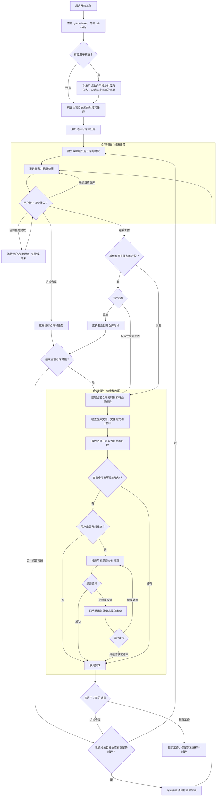

# 标准工作流程：按工作时段推进

边开发、边设计、边讨论、边记录；每次推进一个范围清晰、可验证的小任务。用户的明确指令及当前仓库适用的协作规则优先。

## 统一名称

- **工作时段**：用户一次连续的工作时间，可以涉及多个仓库。
- **仓库时段**：某个仓库在工作中的独立记录，保存在该仓库的一份 Markdown 文档中。
- **时段状态**：仓库时段的状态，使用“进行中”或“已完成”；已完成表示该时段收尾完成，不表示仓库所有任务已完成。
- **时段任务**：在一个仓库时段中推进的具体任务；一个仓库时段可以包含多个任务。
- **待处理任务清单**：所属仓库中尚未开始，或暂停后等待重新安排的任务。
- **最新时段记录**：所属仓库最近的一份时段文档，记录状态、工作进度和连续推进的任务。

恢复某个仓库的工作时，默认先读取其最新时段记录和待处理任务清单；选定任务后，再按需查看相关代码、文档及历史记录。

## 开始工作时段

1. 用户开始工作时，查看主项目根目录的 `.gitmodules`，确认已登记的应用子模块，忽略 `.ai-skills`；没有登记文件或应用子模块时直接检查主项目。
2. 分别检查可读取的子模块和主项目：读取各仓库最新时段记录与 `docs/tasks/pending-tasks.md`，并检查工作区，不逐个读取历史时段。子模块未初始化、无法读取或没有任务记录时说明实际情况，不当作没有任务；遵守项目的 skill 关联限制。
3. 先列出子模块、再列出主项目的当前进度和待处理任务，标明所属仓库，由用户选择；用户已经明确指定仓库和任务时直接开始。
4. 仅查看仓库任务时不创建时段。用户选择任务后，为该仓库建立或继续仓库时段。若最新时段为“进行中”，且用户尚未确认如何处理，询问继续还是新建；不虚构旧时段的结束时间。没有状态的历史汇总按历史快照处理，不据此判断异常中断。
5. 新建时，在所属仓库的 `docs/tasks/sessions/` 创建 `YYYY-MM-DD_序号.md`，记录“进行中”、实际开始时间及所用时区；无法确认时如实标明。同一天可以有多个时段，不因时间自动开始或结束。
6. 选定任务后按需查看代码、项目规则、模块文档和历史记录；保护已有改动。

## 推进与切换任务

- 每次只推进一个可观察或可验证的小任务；复杂事项拆分，未经确认的建议不记为决定。
- 按任务范围遵守所属仓库开发规则；验证与风险相称，记录实际结果、未验证范围和下一步。
- 新想法和未开始的任务记录在所属仓库的 `docs/tasks/pending-tasks.md`；开始实施时移出清单并在时段记录中跟进。
- 当前任务暂停等待重新安排时，记录进度及关联后放回所属仓库待处理清单；短暂切换后继续或跨时段连续推进的事项记录在时段中。
- 当前任务完成后，等待用户选择继续当前仓库、切换仓库或结束工作；不把任务完成自动视为结束工作。
- 用户要切换到其他仓库时，确定目标仓库和任务，再询问是否结束当前仓库时段。选择结束时先按下方收尾流程处理，再进入已选择的目标；选择保留时记录当前进度，保持“进行中”并直接进入目标。
- 目标仓库有本次工作中保留的时段时，返回并继续该时段；否则按启动规则检查其最新记录并建立或继续时段。已由用户确认的选择不重复询问。
- 子模块是独立仓库，任务、验证和后续事项归属于子模块；跨仓库任务分别记录各自工作并建立必要关联，不重复维护细节。提交、推送和指针更新分别遵守授权及适用规则。

## 时段记录

每个仓库各自维护时段记录，包含状态、开始和结束时间，以及两张独立编号的表：已完成任务；进行中或下个时段继续的任务。记录讨论决定、实际验证结果、待验收及下一步；无内容时注明暂无。历史记录是当时的快照。

## 结束工作时段

用户明确结束工作时，先检查其他仓库是否有保留中的时段。如有，询问用户返回其中一个时段，还是继续保留并结束工作；有多个时让用户选择要返回的仓库。返回时按仓库切换流程处理当前时段。选择结束时，收尾当前仓库，其他保留时段继续保持“进行中”。

结束当前仓库时段，不论是结束工作还是切换仓库，均执行以下收尾：

1. 整理当前仓库的时段记录及待处理任务，核对新想法、暂停和未完成任务，区分完成、待验收与未验证。
2. 按项目规则检查并按需更新仓库文档、模块文档和链接，检查工作区，保留已有改动。对已配置格式工具的仓库，先执行格式检查，再按仓库规则修正格式并重新检查；只进行格式调整，保留已有改动。未配置格式工具时记录实际情况，不自动安装。执行适当验证；检查或修正失败、无法运行或仍有文件不通过时记录具体问题，不报告通过。
3. 记录实际结束时间及“已完成”状态，简要报告结果和未提交改动；无法确认时间时不猜测。“已完成”表示时段收尾，不表示所有任务完成。
4. 检查当前仓库是否有可提交改动。没有时直接完成收尾；有时询问用户是否分类提交。用户同意后按适用的提交 skill 和确认流程处理；提交失败或用户取消时说明结果并保留未提交改动，再由用户决定继续处理还是切换或结束。
5. 收尾完成后，按用户先前选择切换到已确定的目标仓库，或结束工作。其他保留中的仓库时段不自动结束；收尾本身不授权推送、部署或删除数据。
